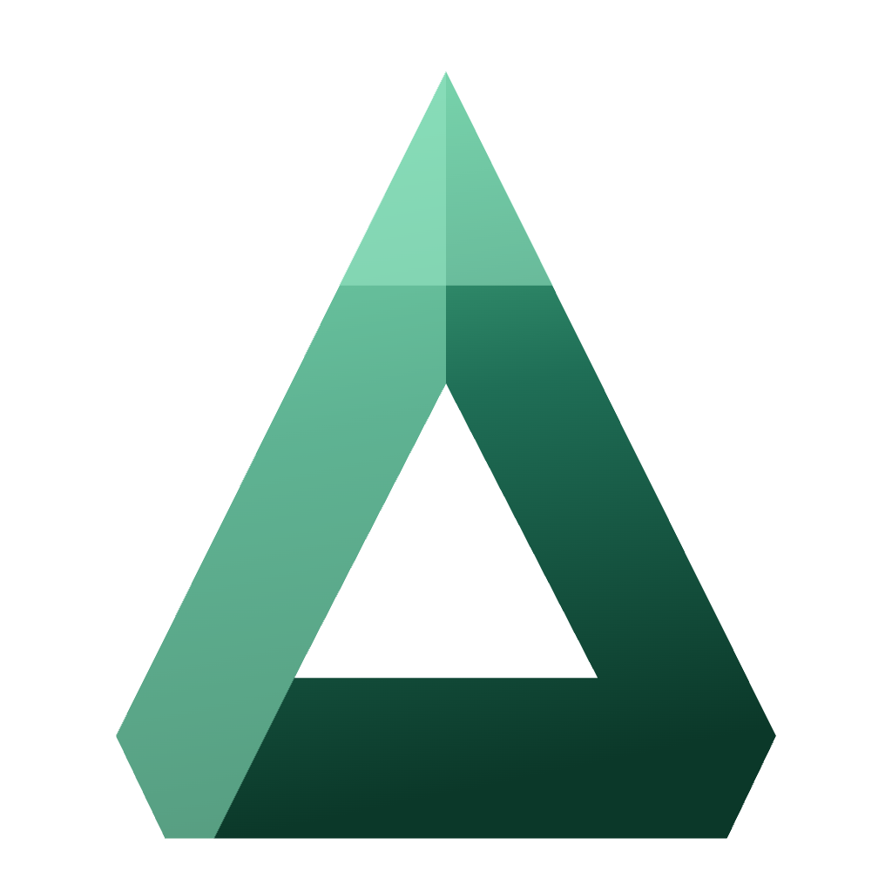

<div align="center">



# Attesta <!-- omit in toc -->

## Authenticated, role-gated stream traceability with evidence capture, policy checks, and Digital Product Passport publishing. <!-- omit in toc -->

</div>

<br>

Attesta turns regulated, multi-party streams into verifiable digital records.
Each organization sees the actions it is allowed to complete, submits structured
data or file evidence, and follows a live timeline from intake to final
notarization.

It is built for traceability demos where accountability matters: policy checks
enforce roles and step order, MongoDB stores process state and attachments,
Appwrite manages organizations and users, and completed streams can publish a
GS1 Digital Link / Digital Product Passport for external verification.

- 🔐 Appwrite-backed sessions, organizations, roles, invites, and user labels.
- 🧾 YAML or Formata Builder streams.
- 🛡️ Cerbos authorization for role and sequence-gated actions.
- 📎 MongoDB and GridFS storage for evidence and attachments.
- ⚡ HTMX pages with SSE updates for live process views.
- 🪪 Optional DPP landing pages and JSON exports under `/01/...`.
- 📡 OpenAPI documentation served at `/docs`.

<br>

---

<div id="toc">

## 🚩 Table of Contents <!-- omit in toc -->

- [🧱 Stack](#-stack)
- [✅ Requirements](#-requirements)
- [⚡ Quick Start](#-quick-start)
- [⚙️ Configuration](#️-configuration)
- [🪪 Digital Product Passport](#-digital-product-passport)
- [🗂️ Project Layout](#️-project-layout)
- [🚢 Deployment Notes](#-deployment-notes)
- [💼 License](#-license)
- [💶 Funding](#-funding)
- [📖 More Documentation](#-more-documentation)

</div>

## 🧱 Stack

- Go 1.25+, `net/http`, `html/template`
- MongoDB 7 and GridFS
- Appwrite for accounts, sessions, teams, memberships, labels, and org assets
- Cerbos PDP for authorization
- Vite, JavaScript, CSS, HTMX, SSE
- Docker Compose for local infrastructure

**[🔝 back to top](#toc)**

---

## ✅ Requirements

Use either the manual toolchain:

- Go 1.25+
- Node.js 18+ with npm
- [Task](https://taskfile.dev)
- Docker and Docker Compose 2.24.4+

Or use [mise](https://mise.jdx.dev/installing-mise.html) plus Docker:

```bash
mise trust
mise install
```

**[🔝 back to top](#toc)**

---

## ⚡ Quick Start

Clone the repo and create local environment settings:

```bash
git clone https://github.com/CLOSERPROJECT/attesta
cd attesta
cp .env.example .env
```

Start local infrastructure, then run the app in development mode:

```bash
task start
task dev
```

`task start` brings up Compose infrastructure for this checkout. With
`ATTESTA_SEED=true` (worktree-env default), it runs prepare so Appwrite can
bootstrap and the demo seed can apply when credentials exist. Full prepare,
seed, and Feragame scope details live in [QUICKSTART.md](QUICKSTART.md).

For the complete stack in Docker instead, use `task start:docker` (see
[DOCKER.md](DOCKER.md) and [QUICKSTART.md](QUICKSTART.md)).

Resolved URLs and ports for this checkout:

```bash
bash scripts/worktree-env.sh print
```

Primary defaults (when `.env.worktree` is absent) follow `.env.example` /
`scripts/dev-ports.env` — typically app on `PORT` (default `3000`), Appwrite on
`APPWRITE_HTTP_PORT`, and Mailpit on `MAILPIT_UI_PORT`.

### Git worktrees

Parallel checkouts get a gitignored `.env.worktree` with isolated ports and a
path-qualified Compose project. Day-1 worktree bootstrap →
[QUICKSTART.md](QUICKSTART.md). Stop/reset/purge and orphan GC →
[DOCKER.md](DOCKER.md).

**[🔝 back to top](#toc)**

---

## ⚙️ Configuration

Common environment variables (see `.env.example` for local defaults):

- `PORT` or `ADDR` - backend listen address, default `:3000`
- `VITE_PORT` - Vite dev-server port, default `5173`
- `MONGODB_PORT`, `CERBOS_PORT`, `APPWRITE_HTTP_PORT`, `APPWRITE_HTTPS_PORT`,
  `MAILPIT_SMTP_PORT`, `MAILPIT_UI_PORT` - host ports for this checkout
- `MONGODB_URI`, `CERBOS_URL`, `APPWRITE_ENDPOINT`, `SMTP_HOST`, `SMTP_PORT` -
  preserved for primary host development; linked worktrees resolve to isolated
  local ports
- `APPWRITE_PROJECT_ID`, `APPWRITE_API_KEY` - prepare writes runtime creds to
  checkout-scoped `.env.appwrite`
- `PUBLIC_BASE_URL` - public origin for invite/reset/verify links (no trailing slash)
- `APPWRITE_ORG_ASSETS_BUCKET` - default `org-assets`
- `ATTACHMENT_MAX_BYTES` - default 25 MiB
- `ANYONE_CAN_CREATE_ACCOUNT` - default `true`; set `false` as an emergency kill switch
- `SESSION_TTL_DAYS`, `COOKIE_SECURE`

**[🔝 back to top](#toc)**

---

## 🪪 Digital Product Passport

When DPP is enabled on a stream and a process first reaches `done`, Attesta
stores stable identifiers and exposes a public Digital Link page at
`/01/{GTIN}/10/{LOT}/21/{SERIAL}` (JSON via `Accept: application/json` or
`?format=json`).

Stream YAML shape, serial strategies, and UNTP mapping live in
[docs/untp.md](docs/untp.md).

**[🔝 back to top](#toc)**

---

## 🗂️ Project Layout

```text
server/       Go server, templates, generated API docs, stream config
web/          Vite frontend bundle source and build output
cerbos/       Cerbos config and policies
deployment/   Dockerfiles and Docker Compose files
Taskfile.yml  Common local development commands
```

**[🔝 back to top](#toc)**

---

## 🚢 Deployment Notes

Before deploying:

1. Set Appwrite project, API key, invite URL, reset URL, and org assets bucket.
2. Set `COOKIE_SECURE=true` behind HTTPS.
3. Open registration is the product default (`ANYONE_CAN_CREATE_ACCOUNT` defaults to `true`); set it to `false` only as an emergency kill switch.
4. Verify MongoDB and Cerbos connectivity.
5. Bootstrap initial organizations and org-admin users in Appwrite.
6. Confirm stream YAML organization and role slugs match Appwrite state.
7. Decide whether public DPP Digital Link routes should be exposed.

Docker and Coolify details live in [DOCKER.md](DOCKER.md).

**[🔝 back to top](#toc)**

---

## 💼 License

```
Attesta
Copyright 2025-2026 Forkbomb bv (forkbomb.eu), The Forkbomb Company.

This program is free software: you can redistribute it and/or modify
it under the terms of the GNU Affero General Public License as
published by the Free Software Foundation, either version 3 of the
License, or (at your option) any later version.

This program is distributed in the hope that it will be useful,
but WITHOUT ANY WARRANTY; without even the implied warranty of
MERCHANTABILITY or FITNESS FOR A PARTICULAR PURPOSE.  See the
GNU Affero General Public License for more details.

You should have received a copy of the GNU Affero General Public License
along with this program.  If not, see <http://www.gnu.org/licenses/>.
```

**[🔝 back to top](#toc)**

---

## 💶 Funding

CLOSER (Circular raw materiaLs for european Open Strategic autonomy on chips and
microElectronics pRoduction, Project No. 101161109) is funded by the European
Union under the Interregional Innovation Investments (I3) Instrument of the
European Regional Development Fund, managed by the European Innovation Council
and SMEs Executive Agency (EISMEA).

Even Closer (Project No. 101228240) is funded by the European Union under the
Interregional Innovation Investments (I3) Instrument of the European Regional
Development Fund, managed by the European Innovation Council and SMEs Executive
Agency (EISMEA).

This repository is part of CLOSER and Even Closer projects and has received funding from the
European Union. Views and opinions expressed are those of the author(s) only and
do not necessarily reflect those of the European Union or EISMEA. Neither the
European Union nor the granting authority can be held responsible for them.

**[🔝 back to top](#toc)**

---

## 📖 More Documentation

- [AGENTS.md](AGENTS.md) - agent behavior, title conventions, and guidance pointers.
- [GLOSSARY-MAP.md](GLOSSARY-MAP.md) - which glossary applies (shared membership, Org `/app`, Stream `/my`, Feragame).
- [QUICKSTART.md](QUICKSTART.md) - prepare-first local setup, seed, and worktrees.
- [DOCKER.md](DOCKER.md) - Compose services, Coolify, stop/reset/purge, and containerized app.
- [docs/architecture.md](docs/architecture.md) - system boundaries, ADRs, and source navigation.
- [docs/untp.md](docs/untp.md) - Digital Product Passport and UNTP implementation.
- [Taskfile.yml](Taskfile.yml) - available local commands.
- GitHub issues - active and deferred work (see [docs/agents/issue-tracker.md](docs/agents/issue-tracker.md)).
