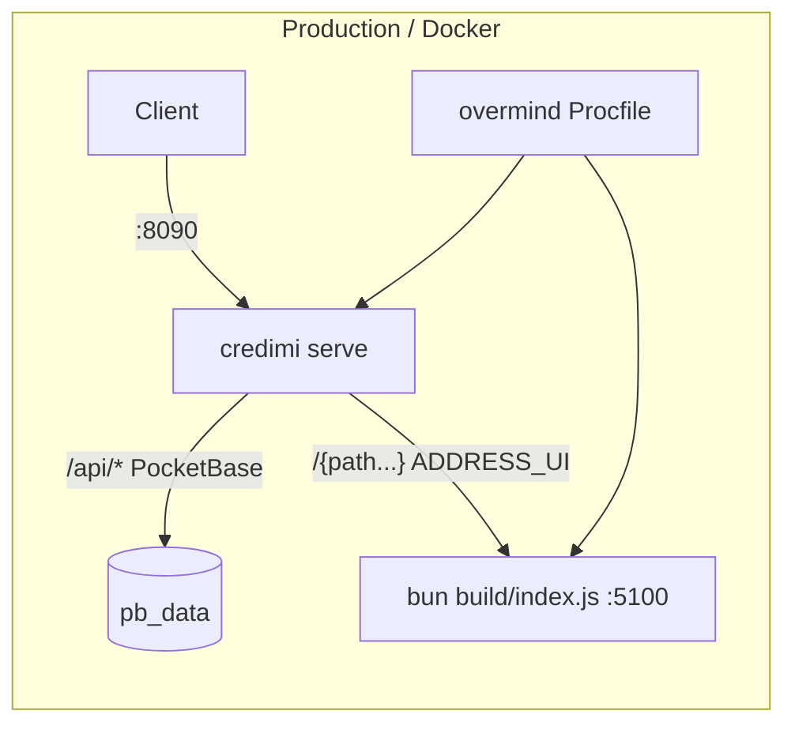
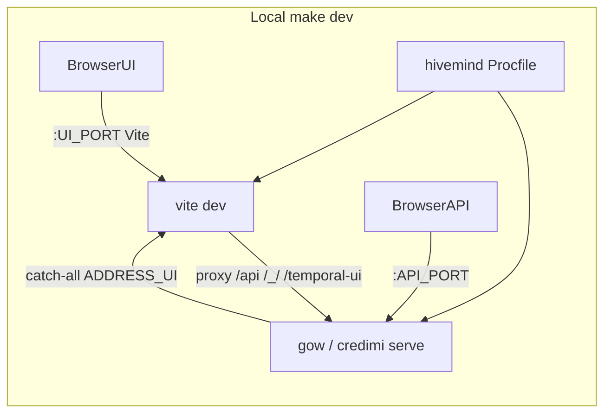

# SvelteKit under Attesta (DIDimo / Credimi pattern)

Research note: how Credimi (`DIDimo`) runs SvelteKit in dev and production, and what Attesta would need to mirror it. Primary sources are the DIDimo and Attesta trees on disk (2026-10-29).

## Verdict

DIDimo does **not** embed the SvelteKit build into Go. It runs **two processes** in one deployment unit:

1. **API** — PocketBase/Go on `:8090` (public entry).
2. **UI** — SvelteKit (`svelte-adapter-bun`) on `:5100`.

The API **reverse-proxies** everything that is not an API path to `ADDRESS_UI`. In dev, Vite does the opposite for `/api/` (and a few other prefixes) so the browser stays same-origin with the UI.

Attesta today is a **single Go process** that renders templates and serves a Vite asset bundle from `web/dist` under `/static/`. Adopting the DIDimo pattern means adding a long-lived UI process and a catch-all reverse proxy — not only scaffolding a SvelteKit app.

## DIDimo architecture





### Key files (DIDimo)

| Concern | Path |
|---|---|
| SvelteKit app | `webapp/` |
| Adapter | `webapp/svelte.config.js` → `svelte-adapter-bun` |
| Vite proxy | `webapp/vite.config.ts` (`VITE_API` → `/api/`, `/_/`, `/temporal-ui`) |
| API → UI proxy | `pkg/routes/routes.go` (`ADDRESS_UI`, default `http://localhost:5100`) |
| Dev process manager | `Procfile.dev` + generated runtime Procfile; `make dev` → hivemind |
| Prod process manager | `Procfile` + `overmind` in root `Dockerfile` |
| Classic ports | `scripts/dev-ports.env` (`API_PORT=8090`, `UI_PORT=5100`) |
| Worktree ports | `.env.worktree` via `scripts/worktree-dev-prepare.sh` |
| Env example | `webapp/.env.example` (`VITE_API`, Turnstile, typegen URLs) |
| Docs | `docs/.../developer-setup.md`, `AGENTS.md` (proxy + same-origin rules) |

### Dev (DIDimo)

1. `make worktree-bootstrap` (parallel checkouts) writes unique ports; syncs PocketBase URLs in `webapp/.env`.
2. `make dev` starts Compose infra, then hivemind with a runtime Procfile:
   - `API`: wait for Temporal → `gow run … serve --http=0.0.0.0:${API_PORT}`
   - `UI`: wait for API → `cd webapp && bun i && PORT=${UI_PORT} bun dev`
3. Browser can use **UI origin** (`:5100`): Vite proxies API paths to `VITE_API`.
4. Browser can use **API origin** (`:8090`): Go proxies non-`/api` to `ADDRESS_UI`.
5. Client PocketBase uses **same origin** (`new PocketBase()` with base `/`). No baked-in public API URL for the browser.
6. SSR (`hooks.server.ts` `handleFetch`) rewrites same-origin `/api/` fetches to `VITE_API`, because SvelteKit would otherwise answer them itself.

### Production (DIDimo)

1. Root `Dockerfile` builds Go binary, `bun i`, `bun run build` in `webapp/` (needs `PUBLIC_*` build args such as Turnstile).
2. `CMD ["overmind", "s", "-f", "/app/Procfile"]`:
   - `API`: `credimi serve --http=0.0.0.0:8090`
   - `UI`: `bun run /app/webapp/build/index.js`
3. Compose sets `ADDRESS_UI=http://localhost:5100` and `PORT=5100` (adapter-bun listen port). Publishes **8090** only.
4. Healthcheck hits `http://localhost:8090`.
5. Absolute SEO URLs use `PUBLIC_SITE_URL` / `SITE_ORIGIN`, **not** the request host (proxy would otherwise leak the internal UI host).

### Env checklist (DIDimo UI)

| Variable | Role |
|---|---|
| `ADDRESS_UI` | API reverse-proxy target (default `http://localhost:5100`) |
| `PORT` / `HOST` | adapter-bun listen (prod UI process; default port 3000 if unset) |
| `VITE_API` | Vite (and SSR `handleFetch`) upstream for `/api/` |
| `PUBLIC_*` | Inlined at **build** time (e.g. Turnstile site key) |
| Private secrets | Runtime only on API (and server hooks if needed) |
| `ORIGIN` / `PROTOCOL_HEADER` / `HOST_HEADER` | adapter-bun docs for correct URL behind proxies; Credimi prefers explicit `PUBLIC_SITE_URL` for SEO |

### Pitfalls DIDimo already documents

- Never proxy unknown `/api/...` to the UI in dev — Vite would proxy them back → loop. Credimi returns 404 for unmatched `/api` on the catch-all.
- SSR must not use the UI origin for PocketBase; use `handleFetch` → `VITE_API`.
- Canonical/redirect absolute URLs must not use the proxied internal host.
- Gzip: PocketBase proxy does not compress; Credimi gzips in `hooks.server.ts`.
- Root layout `ssr = false` with public layout re-enabling SSR for crawlers.

## Attesta today

| Concern | Behavior | Path |
|---|---|---|
| Frontend | Vite library/app build → `web/dist` | `web/` |
| Serving | Go `FileServer` under `/static/` | `server/cmd/server/main.go` |
| Templates | Go HTML templates | `server/templates/` |
| Dev | `task dev` → air (Go) + `npm run dev` (Vite on `VITE_PORT`) | `Taskfile.yml` |
| Ports | `PORT=3000`, `VITE_PORT=5173` | `scripts/dev-ports.env` / `.env.worktree` |
| Docker | Multi-stage: `npm run build` then copy `web/dist` into Alpine image; **single** `./attesta` process | `deployment/Dockerfile.local`, `Dockerfile.coolify` |

There is **no** `ADDRESS_UI`, no Overmind/Procfile dual process, and **no SvelteKit** in-tree. Closest existing “app under Attesta” is **formata-arch**: Svelte 5 + Vite SPA (`sv-router`, not Kit), `base: '/formata-arch'`, built into `attesta/`, **`go:embed`**, served under `/formata-arch` and rewritten under `/my/organization/formata-builder` (`formata_builder.go`). SPA fallback only for that embed. Docker does not rebuild it — prebuilt assets ship in the submodule; CI checks out with submodules.

`web/` must stay the Go-template CSS/JS pipeline; a Kit app should be a **sibling**, not a takeover of `web/`.

## Integration options for Attesta

| Option | Shape | When |
|---|---|---|
| **A. Formata-shaped** | `adapter-static` (or SPA) + `paths.base` + `go:embed` + mux prefix | No Kit SSR; stays one Alpine/`./attesta` process; closest to Attesta today |
| **B. DIDimo-shaped** | `adapter-node` or `svelte-adapter-bun` + Go `httputil.ReverseProxy` to `ADDRESS_UI` | Need SSR/`+server`; same public origin; new UI process |
| **C. Sidecar / Coolify path** | Separate Node service; Coolify or Compose path/host split | Clear process boundary; more cookie/`PUBLIC_BASE_URL` care |

Do not publish a second public UI origin if Appwrite/session cookies must stay shared.

## What Attesta would need to mirror DIDimo (option B)

1. **App location** — e.g. top-level `webapp/` or `apps/<name>/`. Keep `web/` for templates.
2. **Adapter** — Credimi uses `svelte-adapter-bun`; Attesta Alpine images favor **`adapter-node`** unless the runtime image gains Bun.
3. **Go reverse proxy** — after Attesta routes, proxy remaining (or a dedicated prefix) to `ADDRESS_UI`. Never forward Attesta API prefixes to the UI (anti-loop). Ask before changing route ownership.
4. **Dev** — `UI_PORT` in worktree-env/`PORT_KEYS`; `ADDRESS_UI`; Vite proxy for API paths; extend `task dev` (or Procfile/hivemind) so Go + Kit start together. Today Vite for `web/` is **cross-origin** via `VITE_DEV_SERVER` in templates — Kit-behind-Go is a different wiring.
5. **Prod** — build Kit; run Go + UI (Overmind/s6/entrypoint) **or** Compose sidecar; publish only Go `:3000`; Coolify/`PUBLIC_BASE_URL` stay on the Go origin.
6. **SSR `handleFetch`** — rewrite same-origin API fetches to the real Go URL (Credimi: `VITE_API`).
7. **Absolute URLs** — keep using configured `PUBLIC_BASE_URL`, never the proxied internal UI `Host`.
8. **Gzip** — if Go proxy does not compress, Kit should gzip SSR (Credimi does in `hooks.server.ts`).
9. **Healthchecks** — Credimi only probes `:8090`; UI can be down while health passes — probe or wait-for UI if that matters.

### Suggested Attesta env additions (option B)

```text
UI_PORT=5174          # new worktree key; do not collide with VITE_PORT (template assets)
ADDRESS_UI=http://127.0.0.1:${UI_PORT}
VITE_API=http://127.0.0.1:${PORT}   # Vite proxy / SSR handleFetch
```

Keep `PORT` as the **public** Go listen port.

## Pitfalls (from Credimi)

- `/api` (or Attesta API) catch-all → UI while Vite proxies API back → **loop**; 404 unmatched API on the catch-all.
- Dual public origins break same-origin clients and cookies.
- `ADDRESS_UI` port must match UI listen `PORT` (adapter-bun defaults to **3000** if unset).
- SEO/canonicals from request Host leak internal UI host.
- Path collisions: `/static/*`, `/my/*`, `/admin/*`, `/formata-arch/*`, `/api/*`, auth, DPP routes.

## Open questions (decide before implementing)

1. Option **A** (static embed) vs **B** (DIDimo dual-process) vs **C** (sidecar) — SSR required?
2. Replace Go templates entirely, or mount Kit under a prefix while keeping `/`, `/my`, `/admin` on Go?
3. Bun vs Node given Alpine/Coolify.
4. Appwrite session cookies if Vite is the browser entry in dev (second origin).
5. Whether formata-arch stays embed-as-today or moves into the Kit app.

## Sources

- Explorers: [DIDimo SvelteKit](3ca34ec2-9eae-4676-986e-eafef52e2f95), [Attesta frontend](968bfc2e-5f86-471d-a2aa-189bac1f9d77), [proxy/routing](6c598617-15bd-4e10-a558-d70f4a5f9803)
- DIDimo: `pkg/routes/routes.go`, `webapp/{svelte.config.js,vite.config.ts,hooks.server.ts}`, `Procfile*`, `Dockerfile`, `docker-compose.yaml`, `scripts/dev-ports.env`, `AGENTS.md`, developer-setup docs
- Attesta: `Taskfile.yml`, `scripts/{dev-ports.env,worktree-env.sh}`, `deployment/Dockerfile.{local,coolify}`, `server/cmd/server/{main.go,formata_builder.go,templates.go}`, `server/templates/layout.html`, `docs/{architecture,css}.md`
