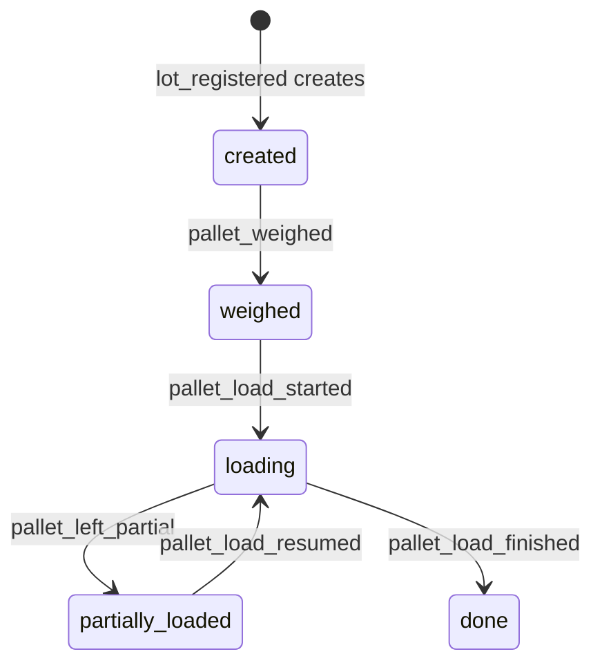
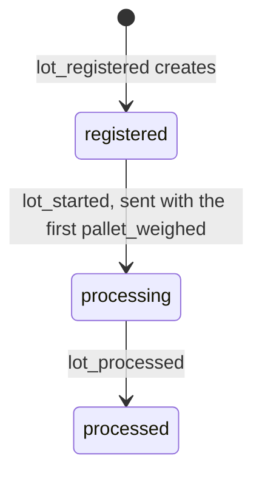
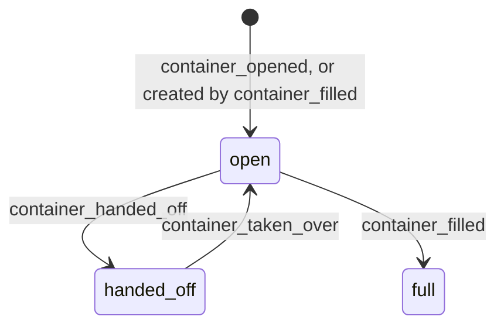

# Interpretation package: the resource model

[`vision.md`](vision.md) says each organization supplies an **Interpretation
package** that declares its resource types, its forms, and the rules that
turn reported facts into a model of the plant. This document describes how
that package is authored: which concepts it is written in, and which rules
the engine enforces on it.

It replaces the authoring model of the current Org Config, where the unit of
configuration is a **Task** inside a **Job**, and anything that repeats over
several things is an array or a dynamic map inside one Task form. The
reasons are concrete; see [Before and after](#before-and-after).

Vocabulary here is *target* vocabulary, like the vocabulary in `vision.md`.
It moves to [`GLOSSARY.md`](../GLOSSARY.md) when it lands in code. YAML in
this document is illustrative: the concepts are decided, the syntax is not.
The full Feragame example is in [`sketch.yaml`](sketch.yaml). The decisions
are recorded in
[ADR-0008](adr/0008-resource-event-lifecycle.md),
[ADR-0009](adr/0009-one-subject-per-event.md), and
[ADR-0010](adr/0010-scopes-and-rea-declarations.md).

---

## Vocabulary

- **Resource type** and **resource**: a kind of material thing the
  organization tracks (lot, pallet, container) and one instance of it.
  Resources can have a quantity and can flow: be received, consumed, or
  produced.
- **Scope type** and **scope**: a frame that work happens in (working day,
  shift, a truck being unloaded) and one instance of it. A scope has a
  lifecycle, contains other things, and can be the subject of events, but it
  never has a quantity and never flows. "Scope" follows REA's `inScopeOf`.
- **State**: where a resource or scope is in its lifecycle. The engine
  derives it from the events that happened to it. Configuration never
  writes it.
- **Event type**: something that can happen to a resource, declared in the
  package (`pallet_weighed`). An **Observation** asserts that an event of
  that type happened to a given resource. For now each Observation describes
  one event; correlating several Observations into one event stays as
  described in `vision.md`.
- **Subject**: the one resource or scope whose lifecycle an event advances.
- **Reference**: a resource or scope that gives the event its context (the
  shift it happened in, the lot on the line), without being advanced by it.
- **Creates**: resources and scopes an event brings into existence.
- **Correction**: an Observation that supersedes an earlier Observation.
- **Board**: every action an operator can take right now.
- **View**: how the board is presented, as a set of screens.
- **Screen**: what the operator sees for one scope or resource: lists of
  things to open, tabs of actions on them, and actions on the screen's own
  scope or resource.
- **Context**: the scopes and resources on the path the operator navigated
  to reach a screen (working day, shift, lot). Events captured on a screen
  take their references from it. Context is navigation; scope is a kind of
  type.
- **Prompt**: an action the board raises as urgent.
- **Check** and **Finding**: a rule evaluated on the reconstructed world,
  and the inconsistency it reports to review.
- **Agent**: a party that provides or receives resources: the organization
  itself, or an external one such as a client.
- **Flow**: what an event does to a resource in REA terms (received,
  consumed, produced), with a quantity. Declared per event type under `rea`.
- **Process**: a transformation that consumes resources and produces
  others, such as processing a lot on the line. Declared as a reading of
  events; operators never act on it directly.

---

## The model

### Resources

A resource type declares its properties, its states, and where it lives.
This pallet is shortened; the full one is in [`sketch.yaml`](sketch.yaml).

```yaml
pallet:
  within: lot
  quantity: [net_weight, panel_count]
  properties:
    lot: { type: reference, resource: lot }
    index: { type: integer }
    gross_weight: { type: number, unit: kg }
    panel_count: { type: integer, unit: panel }
    tare_kind: { type: enum, options: [industrial, euro, custom] }
    custom_tare: { type: number, unit: kg }
  computed:
    tare: "$self.tare_kind = 'custom' ? $self.custom_tare : $lookup($catalogs.tare_kinds, $self.tare_kind)"
    net_weight: $self.gross_weight - $self.tare
  initial: created
  states:
    created: { requires: [lot, index] }
    weighed: &weighed { requires: [lot, index, gross_weight, tare_kind] }
    loading: *weighed
    partially_loaded: *weighed
    done: *weighed
```

- **`within`** marks the reference that means containment: where the
  resource was created. It gives screens their default lists. A screen may
  list resources by another rule: a lot is created within a truck, but the
  shift lists every lot still to be processed, whichever shift registered
  it.
- **`computed`** properties are derived from the resource and its related
  resources, never entered. A truck's current weight is its gross weight
  minus the net weights of the lots already unloaded from it; any event can
  read it.
- **`states`** list everything the resource must have in each state, not
  only what the state adds. A pallet that is `loading` still has its weight.
- **`quantity`** names the properties that measure how much of the resource
  there is, which flows move (see [REA declarations](#rea-declarations)).
  Each has a unit, and no two share one. A pallet has two: its net weight in
  kilograms and its panel count.

#### Requirement: State is derived, never written

The engine SHALL derive a resource's state from the events that happened to
it, starting from the type's `initial` state. No event type and no
expression SHALL write a state directly.

#### Requirement: States declare what a resource has

Each state SHALL declare the properties a resource must have while in that
state (`requires`). Properties SHALL be gained or updated by events and
never removed. History keeps every value; what a state does not show is
expressed by the state, not by deleting data.

#### Requirement: Packages are checked before they run

The package registry SHALL reject a package in which an event type with
`to: S` does not guarantee every property `S` requires. A property is
guaranteed if the event writes it, or if every state in the event's `from`
list already requires it. The same rule applies to the `initial` state of
resources an event creates.

##### Scenario: Missing weight

- **WHEN** a package declares `pallet_weighed` with `to: weighed` but does
  not write `tare_kind`
- **THEN** the package is rejected because `weighed` requires `tare_kind`

### Scopes

Scope types are declared under `scopes`, next to `resources`, with the same
shape: properties, computed properties, `within`, `initial`, and `states`.
Feragame has three. A working day and a shift open and close. A truck is
the frame its lots are unloaded and checked in: the plant neither owns nor
consumes the truck, and its weights exist to check the lots, not to count
stock.

```yaml
scopes:
  shift:
    within: working_day
    properties:
      working_day: { type: reference, scope: working_day }
      kind: { type: enum, options: [first, second, third, whole_day] }
    initial: open
    states:
      open: { requires: [working_day, kind] }
      closed: { requires: [working_day, kind] }
```

A reference property says which kind it points to (`scope: shift` or
`resource: lot`), and so does each entry under `creates`. Names are unique
across both sections.

A scope is not a REA process. A process transforms resources; a shift
transforms nothing, it is when things happened. Treating shifts as
processes would make every lot handled in a shift look like an input or
output of that shift.

#### Requirement: Scopes do not flow

A scope type SHALL NOT declare a `quantity`. A scope SHALL NOT be the
resource of a flow, and SHALL NOT be the input or output of a process. The
package registry SHALL reject a package that breaks this. Scopes MAY have
numeric properties, such as a truck's weights, used by computed properties
and checks.

### Event types

An event type names its subject, the states it moves the subject between,
what the operator enters, what is derived from the input, and what it
writes. Shortened from the sketch:

```yaml
pallet_weighed:
  subject: pallet
  from: [created]
  to: weighed
  roles: [logistic]
  input:
    gross_weight: { type: number, unit: kg }
    average_panel_weight: { type: number, unit: kg, default: 20 }
    tare_kind:
      type: enum
      options: [[industrial, Industriale (25 kg)], [euro, Euro (20 kg)], [custom, Personalizzata]]
    custom_tare: { type: number, unit: kg, when: "$input.tare_kind = 'custom'" }
  derived:
    panel_count:
      overridable: true
      expr: $floor(($input.gross_weight - tare) / $input.average_panel_weight)
  write:
    gross_weight: $input.gross_weight
    tare_kind: $input.tare_kind
    custom_tare: $input.custom_tare
    panel_count: $derived.panel_count
```

An event that brings resources or scopes into existence declares them under
`creates`. They are usually created by an event on their parent: the
administration registers a lot on a truck that is unloading, and that
creates the lot and its pallets. The truck stays `unloading`.

```yaml
lot_registered:
  subject: truck
  from: [unloading]
  to: unloading
  roles: [administration]
  input:
    client: { type: agent, of: clients }
    fir_number: { type: string }
    pallet_count: { type: integer, minimum: 1 }
    truck_weight_after_unload: { type: number, unit: kg }
  derived:
    net_weight: $subject.current_weight - $input.truck_weight_after_unload
  creates:
    - resource: lot
      as: lot
      with:
        truck: $subject.id
        client: $input.client
        fir_number: $input.fir_number
        pallet_count: $input.pallet_count
        net_weight: $derived.net_weight
    - resource: pallet
      count: $input.pallet_count
      with: { lot: $lot.id, index: $index + 1 }
```

Because the parent is the subject, the board offers "new lot" once per
unloading truck, and "new shift" once per open working day.

#### Requirement: At most one subject

An event type SHALL have at most one subject, a resource or a scope. An
event type without a subject SHALL create at least one resource or scope;
it is for things with no parent, such as a working day or a new container.
"The same event on many resources" SHALL be modelled as one event per
resource, never as one event with several subjects.

#### Requirement: Context is a reference

Scopes and resources that give an event its context (the shift, the lot on
the line, the truck) SHALL be references. An event SHALL NOT change the
state of a reference.

#### Requirement: References are resolved at capture

A reference SHALL be resolved when the Observation is captured, normally
from the screen's context (`$context.lot` is the lot whose screen the
operator is on), and the resolved resource ID SHALL be stored in the
Observation. Reconstruction SHALL NOT resolve references again, so replay
does not depend on arrival order. A wrong reference is fixed by a
correction.

##### Scenario: Container weighed on the wrong lot

- **WHEN** an operator records `container_filled` from the screen of a lot
  that is not the one on the line
- **THEN** the Observation stores that lot as its reference, and the weight
  is credited to it
- **AND** the `lot_weight_balance` check reports a finding on both lots
- **AND** a correction that replaces the reference moves the weight

#### Requirement: Availability guides, never gates

An event type MAY declare `available_when`, a condition on its subject or
its context. The board SHALL offer the action only while the condition
holds: once a lot is `processed`, its pallets and containers are no longer
offered. Capture SHALL NOT check it. An Observation captured while the
condition did not hold, for example on a device that was offline when the
lot was marked processed, SHALL be stored and reconstructed, and SHALL
produce a finding.

#### Requirement: One action may send several Observations

An event type MAY declare follow-ups under `also`: other event types the
capture client SHALL send in the same capture, each as its own Observation
with its own single subject. A follow-up names its subject (`subject`), or
one follow-up per matching resource (`for_each`), and MAY be conditional
(`when`). Follow-ups SHALL be resolved at capture from the device's world
model, like references, and stored; reconstruction SHALL NOT add or remove
them. A follow-up's context is the triggering capture's context plus the
triggering subject. Follow-ups MAY chain; the package registry SHALL reject
a cycle. An event type marked `on_board: false` is sent only as a
follow-up. Each Observation of a capture is corrected on its own; the GUI
MAY offer to correct them together.

In Feragame, weighing the first pallet of a lot starts the lot, and
starting a lot takes over every handed-off container:

```yaml
pallet_weighed:
  also:
    - event: lot_started
      subject: $subject.lot
      when: "$subject.lot.state = 'registered'"

lot_started:
  on_board: false
  also:
    - event: container_taken_over
      for_each: containers in handed_off
```

This keeps one subject per event (ADR-0009): the operator acts once, and
each resource still changes through its own Observation.

##### Scenario: A device that missed a handoff

- **WHEN** a device that has not yet received a `container_handed_off`
  starts lot B by weighing its first pallet
- **THEN** its capture takes over only the containers it knows about
- **AND** after sync the board raises "Riprendi contenitore" on the missed
  container, and the `handed_off_containers_taken_over` check reports it
  until it is taken over

The reason for the subject and reference rules is that one subject means one row, one state
transition, and one Observation. That keeps tables simple, keeps offline
conflicts scoped to a single resource, and keeps each Observation safe to
resend and replay. It also matches REA, where each economic event concerns
one resource; [REA declarations](#rea-declarations) describe how event
types map onto it.

### Corrections

#### Requirement: Corrections are not transitions

A correction SHALL be an Observation that references the Observation it
supersedes, with a reason. It either replaces the original's input or voids
it. The engine SHALL recompute the subject's state from the corrected
history. State machines SHALL contain only transitions that physically
happen; undoing a mistake is never modelled as a transition.

##### Scenario: Pallet marked done by mistake

- **WHEN** an operator records `pallet_load_finished` for a pallet that was
  only partly loaded, and a supervisor voids that Observation
- **THEN** the pallet's state is recomputed as `loading`
- **AND** the operator can record `pallet_left_partial`
- **AND** history shows the original Observation, the correction, who made
  it, and why

### The board and views

An operator's **board** is every pair of (event type, subject) such that
the operator holds one of the event type's roles, the subject is in one of
its `from` states, and its `available_when` holds. The subject is a
resource or a scope. Event types without a subject appear once, as an
action that creates something.

#### Screens

A view presents the board as **screens**, one per scope or resource.
Opening one from a list moves one level down; the path walked so far is
shown in the top bar and is the screen's **context**. Any screen can have
lists, tabs, and actions, so the structure is not fixed to a depth, and a
screen with nothing for the operator's roles stays empty.

- **Lists** are scopes and resources to open. By default, a screen lists
  what is `within` it, grouped by type.
- **Actions** sit in the top bar's menu. By default they are the event
  types whose subject is this resource (`shift_closed` on a shift,
  `lot_processed` on a lot). An event on this resource that creates a child
  (`truck_arrived` on a shift) is shown as an "add" button on that child's
  list instead.
- **Tabs** are tables or lists of actions on other resources. By default a
  screen has one tab per event type whose subject is a resource within it,
  and the rows are those resources in one of its `from` states.

A view lists only what differs from the defaults:

- a list built by a rule other than `within` (`rows`);
- a tab that combines several event types on the same subject type
  (`actions`), with an "add" button for an event that creates rows
  (`add`), optional grouping (`group_by`), and rows chosen by a rule;
- labels, order, and whether a tab is a table or a list whose rows open a
  form.

In Feragame, administration navigates working day, shift, then truck,
where it registers lots and checks the truck. Logistics and the line
navigate working day, shift, then lot. Logistics sees the tabs "Pesa
bancali" and "Contenitori"; the line sees "Carico linea". Nobody configures
role-specific screens: the role filter on the board produces them. The
screen definitions are in [`sketch.yaml`](sketch.yaml) (`views`).

A tab that combines event types shows, on each row, the actions whose
`from` includes the row's state. Inputs that those actions share become
columns. In the containers tab, an open container offers "Passa al lotto
successivo" and "Contenitore pieno", both with a total weight column, and a
handed-off container offers "Riprendi contenitore".

Scanning a label works the same way. A QR code encodes a resource ID, and
scanning it opens that resource's actions on the board. Today's
package-level `qr.rules`, which map a scan to a specific Job and Task, are
no longer needed.

#### Requirement: Settled rows send themselves

A table row with a single action SHALL be sent as one Observation as soon
as it is valid and settled: the operator leaves the row or presses Enter.
A row with several actions SHALL be sent when the operator chooses one of
them. Rows SHALL NOT be sent on every keystroke. Editing a row that was
already sent SHALL send a correction. A view MAY offer "submit all" where a
scenario needs it; it still sends one Observation per row.

##### Scenario: Weighing three pallets

- **WHEN** a lot has three pallets in `created` and the operator fills in
  the first row and moves to the second
- **THEN** one `pallet_weighed` Observation is stored for the first pallet
- **AND** the first row leaves the table, because the pallet is now
  `weighed`
- **AND** the other two rows wait

### Prompts, checks, and findings

Capture is never blocked (`vision.md`, "Capture is never blocked by domain
state"). Rules that the plant expects to hold therefore take two forms:

- **Prompts** guide the operator at capture time. A prompt raises an action
  on the board as urgent when a condition holds.
- **Checks** run on the reconstructed world and produce **findings** for
  review.

```yaml
prompts:
  settle_containers_before_lot_processed:
    when: a lot in processing has no pallets left in weighed, loading, or
      partially_loaded, and containers are still open in it
    raise: container_handed_off or container_filled on each of those
      containers, then lot_processed

checks:
  lot_weight_balance:
    for_each: lot in processed
    expect: sum of weight credited to the lot across containers is within
      tolerance of the lot's net weight
```

Prompts are shown where the operator is, as a banner or a badge on the
action they raise, and never only inside the top bar's menu.

#### Requirement: Ordering rules never reject

An ordering or consistency rule SHALL be expressed as a prompt, a check, or
both. It SHALL NOT reject an Observation.

### Effects and read-only display

An event type may declare **effects**, such as printing pallet labels or
downloading a registration CSV when a lot is registered. They correspond to
today's `onSubmit.http` and the `living-http` sidecar. Following
`vision.md` (Effect port), effects run after reconstruction, keyed by
Observation ID so they are idempotent, and their outputs are stored as
evidence. Effects cannot change resources.

An event type may also declare values to **show** on its form without
asking for them, such as the truck's current weight while registering a
lot, or the truck-versus-lots comparison when the administration checks a
truck. They replace today's `chrome` readonly fields and `dataReport`.

### REA declarations

The package declares how its events read in REA terms (Resources, Events,
Agents), using the [Valueflows](https://www.valueflo.ws/) vocabulary.
The engine computes nothing from these declarations yet: events still write
quantities, and genealogy is still computed from references. They are
declared now so that history captured from today can later be replayed into
a REA ledger without mapping every event type by hand.

- **Agents** (`agents`) are the external parties, in named groups.
  Feragame's clients were a catalog; now they are agents, and a lot's
  `client` property has type `agent`. `$org` is the organization itself.
- **Quantity** is declared on resource types (see [Resources](#resources)).
- **Flows** (`rea` on an event type) give the Valueflows action, the
  resource it acts on, the quantity, and, for transfers, the provider and
  receiver. An event type without `rea` moves nothing: a measurement
  (`pallet_weighed`), a lifecycle step (`pallet_load_started`), or an event
  on a scope.
- **Processes** (`processes`) group flows into transformations.

```yaml
lot_registered:
  rea:
    action: transfer
    resource: $lot
    quantity: $lot.net_weight
    provider: $input.client
    receiver: $org

pallet_load_finished:
  rea:
    action: consume
    resource: $subject
    quantity: [$subject.net_weight, $subject.panel_count]

processes:
  lot_processing:
    per: lot
    begins: lot_started
    ends: lot_processed
    inputs:
      pallet_load_finished: $subject.lot
    outputs:
      container_handed_off: $references.lot
      container_filled: $references.lot
```

Feragame has three flows and one process:

| Event type | Action | Resource | Quantity |
|---|---|---|---|
| `lot_registered` | transfer (ownership and custody), client to the plant | the new lot | its net weight |
| `pallet_load_finished` | consume, input of the lot's processing | the pallet | its net weight and panel count |
| `container_handed_off`, `container_filled` | produce, output of the processing of the referenced lot | the container | this total minus the previous total |

A pallet left `partially_loaded` records no flow. It is consumed in full
when it is finished, possibly in a later shift; the process belongs to the
lot, not to the shift, so that is still correct. `$references.lot` is the
reference stored on the Observation, so a container weighed on the wrong
lot moves its output when the reference is corrected.

#### Requirement: REA declarations are checked

The package registry SHALL validate `agents`, `quantity`, `rea`, and
`processes`: actions come from the Valueflows action list, every quantity
has a unit and no two quantities of a resource share one, a flow's
quantities match its resource's, scopes do not flow, and every event type
a process names exists.

#### Requirement: Flows are not computed yet

Reconstruction SHALL NOT derive states, properties, findings, or passports
from these declarations until computing flows is decided (see
[Open questions](#open-questions)).

#### Requirement: Processes are readings of events

A process SHALL be declared over one resource type (`per`), with the event
types that begin and end it, and the event types whose flows are its
inputs and outputs, each with an expression that selects the process it
belongs to. A process SHALL NOT have states, screens, or event types of its
own.

#### Requirement: Quantities are measured, not accumulated

A resource's `quantity` property SHALL be written only by events that
measure it, such as registration or weighing. Amounts that follow from
flows, such as what is left of a lot, SHALL be computed properties, so that
computing them from flows later does not leave a second, conflicting value.

### Identity

#### Requirement: Identity is minted at the source

Resource IDs SHALL be minted where the creating Observation is captured,
usually on the device, and SHALL be globally unique. Display labels (such
as `C-12` for a container) SHALL be separate from identity and MAY be
assigned later by reconstruction.

---

## Worked examples (Feragame)

### Pallet and line load

A truck arrives, its lots are registered one at a time while it unloads,
and registering a lot creates its pallets. The logistics team weighs each
pallet. On the line, an operator takes a
weighed pallet and loads its panels one by one: that is the pallet's
`loading` phase. If the shift ends mid-load, the operator marks only the
pallets that were started and not finished as `partially_loaded`; they
resume in the next shift. Two pallets may occasionally load at once, but two
lots are never mixed on the line.



Every loading event references the shift from the screen's context. A
`done` pallet returns to `partially_loaded` only through a correction.
Pallet events are available only while their lot is `processing`, except
that the first pallet of a `registered` lot can be weighed, which starts
the lot.

### Lot

A truck, once unloaded, has produced its lots, which go to the storage
area. Each lot is then processed on its own: weighing its first pallet
starts it, the line loads its pallets, and logistics marks it processed.
Pallets are weighed only while their lot is processing. Two lots are never
processed at once, so the lot in `processing` is the lot on the line, and
the first pallet of a new lot can be weighed only once the previous lot is
processed.



`lot_processed` is an explicit event, not the computed `exhausted`,
because the operator's statement that the lot is finished is what changes
the board: the lot leaves the shift's list, and its pallets and containers
are no longer offered. The `lot_processed_when_exhausted` check reports a
lot marked processed while pallets are still not `done`.

### Container

A container collects one material from the line. The operator reads the
**total** weight off the scale. When a lot has been fully processed, the
operator weighs every container still open in it and decides, per
container, whether it is full or is handed off to the next lot with a
partial weight. Then the operator marks the lot processed and starts the
next one, which takes over all the handed-off containers at once. A container is not
weighed at the end of a shift. A full container's empty successor for the
same material is created with it.

```yaml
container:
  within: lot
  properties:
    lot: { type: reference, resource: lot }
    material: { type: enum, options: $catalogs.materials }
    total_weight: { type: number, unit: kg }
    predecessor: { type: reference, resource: container }
  computed:
    weight_by_lot: per weighing, total minus the previous total, keyed by the weighing's lot
    lots: the lot it was opened in, the lots that took it over, and the keys of weight_by_lot
  initial: open
  states:
    open: { requires: [lot, material] }
    handed_off: { requires: [lot, material, total_weight] }
    full: { requires: [lot, material, total_weight] }

container_handed_off:
  subject: container
  from: [open]
  to: handed_off
  references: { lot: $context.lot }
  input: { total_weight: { type: number, unit: kg } }
  write: { total_weight: $input.total_weight }

container_taken_over:
  subject: container
  from: [handed_off]
  to: open
  references: { lot: $context.lot }

container_filled:
  subject: container
  from: [open]
  to: full
  references: { lot: $context.lot }
  input: { total_weight: { type: number, unit: kg } }
  write: { total_weight: $input.total_weight }
  creates:
    - resource: container
      with: { lot: $context.lot.id, material: $subject.material, predecessor: $subject.id }
```



`within: lot` records the lot a container was opened in. A container
shared by several lots appears on the screen of each of them, through its
computed `lots`; containment stays single.

The weight credited to a lot is the weighing's total minus the container's
previous total (zero for a new container). A container can therefore carry
a partial weight for any number of lots, which generalizes today's
`sourceLoadId` and `secondarySourceLoadId`. The weight per lot and the
genealogy of each container are computed from its weighings; no one enters
them. A mismatch between the weights credited to a lot and the lot's own
weight is a finding of the `lot_weight_balance` check, not a capture error.

"Full" and "handed off" are two event types, not one event whose target
state depends on an input, because they reach different states and only
"full" creates a successor. The containers tab still shows them as one
table: each open row offers both actions, with the total weight as a shared
column.

##### Scenario: Changing lot on the line

- **WHEN** lot A has no pallets left to load and three containers are open
  in it
- **THEN** the board raises "Passa al lotto successivo" or "Contenitore
  pieno" on each container, then "Lotto lavorato" on lot A
- **WHEN** the operator hands off two containers at 140 kg and 60 kg, fills
  the third at 300 kg, and marks lot A processed
- **THEN** lot A is credited with the three deltas, a new empty container
  replaces the full one, and lot A leaves the shift's list
- **WHEN** the operator weighs the first pallet of lot B
- **THEN** the capture sends `pallet_weighed`, `lot_started` for lot B, and
  `container_taken_over` for each of the two handed-off containers
- **AND** their next weighing credits lot B with the weight above 140 kg
  and 60 kg

---

## Before and after

### `line/lineLoad/mark` (`feragame-config.yaml`, lines 489–537)

Today, a repeatable `lineLoad` Task group exists so the operator can submit
the pallet table more than once. The Task's value is a map from pallet ID to
`partial` or `done`, with rows selected by `reads.rows.where`
(`$exists(weight) and $not(progress = 'done')`). To support it the engine
expands the map into one schema property per pallet (`form_project.go`),
prefills `partial` cells (`form_bundle.go`), switches to partial-map mode
(`prepDynamicMapFacts` in `prep.go`), drops untouched cells
(`filterFilledCells` in `rows.go`), and re-validates the touched pallet IDs
against the live rows on Commit (`validateCellFacts` in `rows.go`). A
pallet marked `done` leaves the table and cannot be corrected.

In the resource model, each row is a pallet in `weighed`, `loading`, or
`partially_loaded`, and each action is its own event type. No group, Spawn,
Close, or cell map is needed. A mistake is a correction.

### `line/containerReg/register` (lines 538–714)

Today, one form holds eight arrays, one per material. Containers left
incomplete by an earlier load come back prefilled through `initialData`,
marked with a hidden `continuesContainerId` and shown with a `presenceMark`
badge. On Commit, a `bind` expression (lines 668–692) flattens the arrays,
computes each row's weight as a delta from the old container, and builds a
supersede map. `mintMany` mints new containers with IDs counted from the
existing ones (`'C-' & $string($count($domain.container.*) + 1)`), a
`patch` marks the load `fullyProcessed`, and a `patchEach` clears
`incomplete` on the superseded containers. In effect, a container filled
across two loads is represented as two containers and a supersede link.

In the resource model, the container is one resource across lots: it is
handed off at the end of a lot and taken over by the next one. Material is
a property, and the table groups rows by it. The per-lot weight and the
source lots are computed from weighings, which replaces
`continuesContainerId`, the supersede map, and `secondarySourceLoadId`. The
`fullyProcessed` patch becomes the `lot_processed` event. IDs are minted at
the source; `C-N` is a display label.

### What the engine no longer needs

- The `mapTable` cell projection.
- Partial-map mode, the untouched-cell filter, and live row re-validation
  (`prep.go`, `rows.go`).
- `initialData` prefills for continuation, and `presenceMark`.
- The `supersede` bind and counting existing entities to mint IDs.
- Repeatable groups whose only purpose is allowing another submit.
- `qr.rules` mapping scans to Jobs and Tasks.

### What the engine needs instead

- State derivation from events, and the package check on `requires`.
- A generic table view: rows from the board, columns from event inputs, an
  empty row for creating event types, settled rows sent automatically, and
  several actions per row.
- Screens with lists, tabs, and actions derived from `within`, subjects, and
  roles, with view overrides; references resolved from the screen's
  context; `available_when` on the board.
- Follow-ups (`also`): one capture sending several Observations, resolved
  on the device, with a cycle check in the registry.
- Computed properties, derived inputs, read-only display, prompts, and
  checks.
- Effects that run after reconstruction.
- Corrections, device-minted IDs, and display labels.
- Package validation of scopes and REA declarations (no computation yet).

### What becomes harder

One Submission no longer updates several things at once. Today, registering
containers touches the load and all its containers in one Commit; in the
resource model the in-between states are visible (some containers weighed,
the lot not yet exhausted). That is correct for capture and for offline
work, and it is why rules across rows become prompts and checks.

---

## Mapping from today's Org Config

| Today | Resource model |
|---|---|
| Job | A scope type (working day, shift) |
| Job instance | A scope |
| `catalogs.clients` | Agents |
| Task | An event type |
| Task group, Spawn, Close | An event on the parent that creates a child, and an event that closes it |
| Dynamic-map or array Task | A table view over one event type |
| `readyWhen`, unlock order, `startsWhen` | `from` states of the subject, `available_when`, prompts, checks |
| Worklist | The board |
| Home, Overview, Task routes | Screens: lists, tabs, and actions |
| `fullyProcessed` and similar flags | States reached by explicit events (`lot_processed`), or computed properties (`exhausted`) |
| `derived` fields | Derived inputs |
| `chrome` readonly fields, `dataReport` | `show` on the event type |
| `onSubmit.http`, `living-http` sidecar | Effects |
| `qr.rules` | Scanning opens the resource's actions |
| Root `passport` block | Passport declared on a resource type, sealed by a Review case |
| IDs built from counts (`C-N`, `CO-260109-2`) | Device-minted IDs plus display labels |

Role slugs (`line`, `logistic`, `administration`) are kept as they are
today, since Cerbos policies and Appwrite memberships use them.

Conflicts with existing ADRs:

- **ADR-0005** projects the worklist on the server from Tasks and forbids
  the SPA from re-implementing the rules. The board replaces Task statuses
  with (event type, resource) pairs. `vision.md` already reopens ADR-0005
  so the same rules can run on the device.
- **ADR-0006** builds the operator home, overview, and next-step routing on
  Jobs, Job instances, and Tasks. Hierarchy and table views replace them.
- **ADR-0007** uses the Job instance ID as the passport subject. In this
  model the subject is a resource (a lot), which fits better; the passport
  lock itself becomes a Seal as described in `vision.md`.

---

## Open questions

- **Syntax** for views, prompts, checks, and computed properties.
- **References outside the context.** References are resolved at capture,
  usually from the screen's context. How is a reference expressed when it is
  not on the path, for example a scan from a resource's own screen?
- **Correction rights.** Who may correct an Observation: the event type's
  roles, a supervisor, a reviewer?
- **Ordered display labels.** Labels such as a lot's per-client progressive
  number or `C-N` depend on an order. Arrival order is not deterministic, so
  which order do they use: occurrence time, device sequence, or assignment
  at sealing?
- **Computing flows.** Flows will be computed when the passport is built
  from them and for transfers between companies; not needed now. Open: when,
  and what the passport takes from them (today's snapshot already lists a
  lot's pallets and the containers credited to it, which are the inputs and
  outputs of `lot_processing`).
