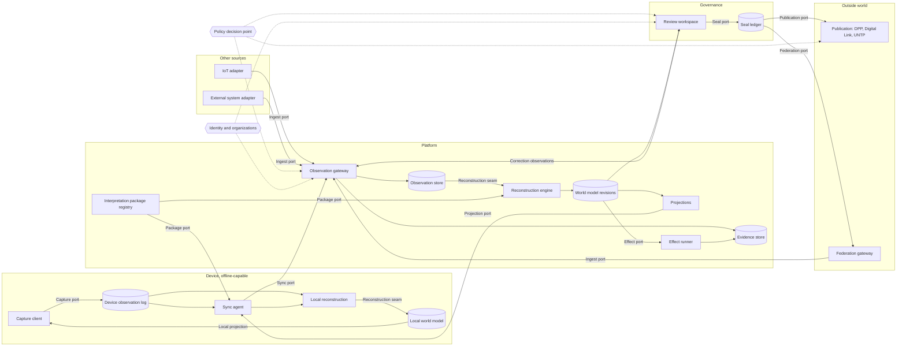

# Attesta: vision, target architecture, and gap analysis

This document describes what Attesta is meant to become, the architecture that
gets it there, and how far the current Living Attesta MVP (`/app`) is from it.
It assumes no prior knowledge of the codebase.

Vocabulary introduced here (**Observation**, **Reconstruction**, **World model
revision**, **Review case**, **Seal**, **Local world model**,
**Interpretation package**) is *target* vocabulary. It is not yet in
[`GLOSSARY.md`](../GLOSSARY.md); terms move there through the domain-modeling
workflow as decisions land. Part 1 uses OpenSpec requirement and scenario
blocks (`SHALL`, `WHEN` / `THEN`) so each behavior is testable; Part 2 is
design prose; Part 3 groups gaps as **Keep / Modify / Add / Retire**.
Headings sit one level deeper than OpenSpec's `spec.md` layout; promote them
by one level when extracting a capability into `openspec/specs/`.

---

## Part 1: Scope and behavior

### What Attesta is

Attesta is a **system of record for industrial reality**. It traces what
physically happens inside a plant (materials arriving, being cut, assembled,
weighed, packed, shipped) and, later, how materials flow **between plants and
companies**.

The **Digital Product Passport (DPP)** is one *output* of that record, not its
purpose. Reports, inventory, genealogy, and inter-company traceability are
others.

The platform is **configuration-driven**. The engine knows nothing about
steel, pallets, or any specific plant. Each organization supplies an
**Interpretation package** that declares its resource types, its forms, and
the rules that turn reported facts into a model of the plant.

### The three layers of truth

Attesta separates three things that conventional apps conflate:

- **What was reported.** An operator or a machine reports something. This is
  an **Observation**: raw, attributed, timestamped, never edited.
- **What we believe happened.** A deterministic **Reconstruction** turns all
  observations into a **World model**: resources, lots, events, agents, flows.
- **What has been accepted.** A human **Review case** inspects a specific
  reconstruction and **Seals** it. Only sealed revisions are published.

The operator GUI belongs entirely to the first layer. It **sends data**, like
feeding a data lake. It does not edit the domain, and it does not decide what
is true.

### Who uses it

**Operators** on the plant floor record what they see, often on shared
devices, sometimes without connectivity. They need forms that follow the
work as it unfolds.

**Reviewers** (quality, compliance, plant management) inspect reconstructed
reality, resolve inconsistencies, and seal revisions.

**Downstream consumers** (customers, regulators, partner companies) read
published passports and traceability links. Partner companies are
**independent agents**, not tenants of one shared database.

**Machines** (scales, line sensors, ERPs) will later report observations
through the same channel as people.

### The domain model: REA

The world model follows **REA** (Resources, Events, Agents), with
[Valueflows](https://www.valueflo.ws/) as the reference vocabulary.

A **Resource type** (aluminium sheet) is distinct from a **Resource instance**
(lot A, 500 kg). **Economic events** (received, consumed, produced,
transferred) change resources through **stockflows** with explicit
**quantities and units**. **Processes** (cutting, assembly) group events.
**Agents** (operators, companies, machines) participate. **Genealogy** links
outputs to the inputs they came from.

Ownership and custody are distinct. Locations are first-class.

How an organization declares its resources, their lifecycles, and the event
types operators report on them is described in
[`interpretation-package.md`](interpretation-package.md).

### Out of scope (for now)

**Planning** is out of scope: the system records what happened (human
observations, later machine observations), not instructions of what should
happen. Commitments may come later.

**Collaborative editing (OT/CRDT)** is out of the core. Observations are
independent records; they do not need merging. Collaborative editing may
appear later inside the review workspace only.

### Capability: Observation capture

**Purpose.** Reliably record what a person or machine reported, with full provenance,
whatever the current state of the world model.

#### Requirement: Capture is never blocked by domain state

The system SHALL accept any well-formed, authorized Observation regardless of
whether the current world model considers it expected, in order, or
consistent. Inconsistencies SHALL surface downstream as findings, never as
capture rejections.

##### Scenario: Out-of-order report

- **WHEN** an operator reports a pallet weighing before its lot is known to
  the central world model
- **THEN** the Observation is stored
- **AND** reconstruction raises a finding for review instead of rejecting it

#### Requirement: Guidance instead of gating

Ordering rules the plant expects to hold SHALL guide the operator as
**prompts** (urgent actions on the board) and SHALL be checked downstream as
**findings**. They SHALL NOT reject an Observation
([`interpretation-package.md`](interpretation-package.md), "Prompts, checks,
and findings").

#### Requirement: Observations are immutable and self-identified

Each Observation SHALL carry a globally unique ID minted at the source,
before transmission. The system SHALL never update or delete a stored
Observation.

##### Scenario: Duplicate submit after a network drop

- **WHEN** a device re-sends an Observation whose ID is already stored
- **THEN** the system acknowledges it without storing a second copy

#### Requirement: Three timestamps

Each Observation SHALL record when the fact **occurred**, when it was
**recorded** at the source, and when the platform **received** it. The system
SHALL NOT assume device clocks are accurate or that arrival order is
chronological.

#### Requirement: Provenance

Each Observation SHALL record its source type (human or machine), source
identity (user, device), the Interpretation package version the source was
using, the raw payload, and references to evidence (photos, documents,
measurements).

### Capability: Corrections

**Purpose.** Let people fix mistakes without erasing history.

#### Requirement: Corrections are new observations

A correction SHALL be a new Observation that references the one it corrects,
with a reason. The original SHALL remain stored and visible in history.

##### Scenario: Wrong quantity entered offline

- **WHEN** an operator records 100 kg consumed, then corrects it to 90 kg
  while still offline
- **THEN** both Observations sync
- **AND** the reconstructed state reflects 90 kg
- **AND** history shows the original value, the correction, who made it, and
  why

### Capability: Offline capture and sync

**Purpose.** Let operators keep working when connectivity is poor or absent.

#### Requirement: Durable local log

The capture client SHALL persist every Observation in durable local storage
before attempting upload. A failed upload SHALL NOT mean failed capture.

#### Requirement: At-least-once sync with server acknowledgement

The device SHALL upload Observations in batches and retry until the platform
durably acknowledges each ID. The device SHALL NOT mark an Observation
synced, or discard it, on mere upload attempt.

##### Scenario: Connectivity returns

- **WHEN** a device with 4 pending Observations regains connectivity
- **THEN** it uploads them
- **AND** marks as synced only the IDs the platform acknowledged
- **AND** keeps the rest queued

#### Requirement: Visible sync status

The capture client SHALL show the operator how many Observations are
synced, pending, and requiring attention.

### Capability: Local world model and evolving forms

**Purpose.** When an observation produces a new entity, the operator must be able to
continue the workflow on that entity even offline.

#### Requirement: Local provisional reconstruction

The device SHALL run the same reconstruction rules as the platform, for the
subset of the workflow assigned to it, over its local Observations plus
cached reference data. Entities it creates SHALL be marked provisional.

##### Scenario: New batch offline

- **WHEN** an operator offline records a completed production operation
- **THEN** the local reconstruction creates a provisional batch
- **AND** the batch's forms become available on the device
- **AND** further Observations about that batch reference its local ID

#### Requirement: Stable provisional identity

Entity IDs minted on a device SHALL be globally unique and SHALL be preserved
by central reconstruction when it agrees with the device's interpretation.

#### Requirement: Forms derive from entity types and rules

The capture client SHALL render forms and available actions from the
Interpretation package and the local world model, not from a hard-coded
sequence. Available actions are pairs of an event type and a resource in one
of its allowed states
([`interpretation-package.md`](interpretation-package.md), "The board and
views").

### Capability: Reconstruction

**Purpose.** Turn the observation log into a coherent, explainable model of the plant.

#### Requirement: Determinism

Given the same set of Observations and the same Interpretation package
version, reconstruction SHALL produce the same World model revision,
independent of arrival order. Each revision SHALL be identified by a content
hash over its inputs.

##### Scenario: Reproduce a sealed revision

- **WHEN** a reviewer asks how a sealed passport was derived
- **THEN** the system replays the sealed Observation set with the sealed
  package version
- **AND** obtains the identical revision hash

#### Requirement: Findings instead of rejections

Reconstruction SHALL represent inconsistencies (missing predecessors,
quantity imbalance, conflicting reports) as **findings** attached to the
revision.

#### Requirement: Explicit identity resolution

When reconstruction determines that two provisional entities are the same
physical thing (or that one is really two), it SHALL record an explicit
identity-resolution record. It SHALL NOT rewrite the Observations that
reference either ID.

#### Requirement: Observation and event are distinct

Several Observations (an operator report, a scale reading) MAY describe one
economic event. Reconstruction SHALL correlate them into one event that keeps
links to all of its Observations.

### Capability: Review and sealing

**Purpose.** Make human accountability explicit and bind it to exactly what was accepted.

#### Requirement: Review case scope

A Review case SHALL have a scope (a lot, an order, a product, a period, a
passport subject), the World model revision under review, its findings,
reviewer actions, and an outcome (approved, rejected, needs changes).

#### Requirement: Seals bind to a revision

A Seal SHALL reference one World model revision hash and the exact
Observation set and package version that produced it. A Seal SHALL be
immutable.

##### Scenario: Late observation after sealing

- **WHEN** a correction arrives for a lot that is already sealed
- **THEN** a new revision is reconstructed
- **AND** the existing Seal is unchanged
- **AND** a new Review case is opened for the affected scope

#### Requirement: Reviewer edits are observations

Reviewer corrections SHALL enter the system as Observations attributed to the
reviewer, so they replay like any other input.

### Capability: Publication

#### Requirement: Publish only sealed facts

DPPs and other external projections SHALL be built only from sealed
revisions. Each publication SHALL be versioned and SHALL reference its Seal.

##### Scenario: Passport resolved by Digital Link

- **WHEN** a consumer resolves a GS1 Digital Link for a sealed product
- **THEN** the system serves the HTML passport and the UNTP credentials built
  from that Seal

### Capability: Inter-company traceability

#### Requirement: Independent records, linked by evidence

Each organization SHALL keep its own observations and world model. A transfer
between organizations SHALL be represented as paired events on both sides,
linked by shared identifiers and exchanged evidence, without either side
reading the other's internal store.

##### Scenario: Components shipped to a partner

- **WHEN** plant A seals a transfer of component lot L to company B
- **AND** company B records receipt of lot L
- **THEN** both world models link the two events
- **AND** B's genealogy can reference A's published evidence for L

### Capability: Machine ingestion (future)

#### Requirement: Same envelope as humans

Machine Observations SHALL use the same envelope as human ones and SHALL be
authenticated per device.

#### Requirement: Measurement is not an event

The system SHALL NOT assume a measurement proves an economic event. A weight
change may mean consumption, transfer, spillage, or error; reconstruction
decides with context.

### Capability: Authorization

#### Requirement: Authorize the source, not the world state

At capture, policy SHALL decide whether this source may report this kind of
Observation for this organization. Whether the report is expected given the
world model is a reconstruction concern. Review, sealing, and publication
SHALL each have their own policy checks.

---

## Part 2: Target architecture

### Overview

The architecture follows the three layers of truth. Data flows one way, from
**acquisition** through **reconstruction** to **governance** and
**publication**. Nothing downstream writes back into the observation log
except as a new Observation.

The most important seam is the **Reconstruction seam**: a pure function from
(observations, package version) to a World model revision. The same contract
runs on devices and on the platform. Everything else is plumbing around it.

### Ports and seams

**Capture port.** The only way the GUI produces data: append an Observation
envelope (ID, source, times, package version, payload, evidence refs) to the
local log. The GUI never calls the platform directly to change state.

**Sync port.** Device-to-platform protocol: upload a batch, receive per-ID
acknowledgements, retry the rest. Also the download path for packages,
reference data, and central projections. Idempotent by Observation ID.

**Ingest port.** The same envelope for every non-GUI source: IoT adapters,
external systems, the federation gateway, and reviewer corrections.

**Package port.** Distributes versioned Interpretation packages to the
platform engine and, through sync, to devices.

**Reconstruction seam.** `reconstruct(observations, package) -> revision`.
Pure, deterministic, order-independent. One implementation, two runtimes
(device and platform). This seam is what makes replay, audit, offline work,
and testing possible.

**Projection port.** Read models derived from a revision (worklist,
inventory, genealogy, recap) delivered to clients. Read-only.

**Effect port.** Side effects declared by the package (generate a label PDF,
export a CSV) run *after* reconstruction, keyed by Observation ID so they are
idempotent. Their outputs are stored as evidence.

**Seal port.** Turns an approved Review case into an immutable Seal record.

**Publication port.** Builds versioned external artifacts from Seals only.

**Federation port.** Exchanges sealed evidence with partner organizations and
ingests theirs as Observations.

### Components

**Capture client.** The operator GUI. Renders forms and actions from the
Interpretation package over the Local world model. Mints Observation IDs and
provisional entity IDs. Shows sync status. Holds unsent drafts. Knows nothing
about plants.

**Device observation log.** Durable, encrypted local store of every
Observation and evidence file captured on the device, with sync state per ID.
Never pruned on upload; retention is explicit.

**Local reconstruction.** The reconstruction engine running on the device
over local Observations plus cached reference data, restricted to the
workflow slice the device's package covers. Produces provisional entities.

**Local world model.** A replayable projection, not a cache. Rebuilt from the
local log whenever new Observations, a new package, or central projections
arrive. The GUI subscribes to it.

**Sync agent.** Drives the Sync port: upload, acknowledge, retry, download
packages and reference data, reconcile local provisional state with central
projections.

**IoT adapter and External system adapter.** Translate machine or ERP output
into Observation envelopes. Authenticate per device or per integration.
Perform no interpretation.

**Observation gateway.** Authenticates the source, asks policy whether this
source may report this Observation type, validates the envelope schema,
deduplicates by ID, stamps `received_at`, and appends. It never checks domain
state.

**Observation store.** The append-only log. Partitioned by organization.
Indexed for replay by scope. This is the system's primary record.

**Evidence store.** Content-addressed storage for attachments and generated
artifacts, referenced from Observations and effects.

**Interpretation package registry.** Versioned packages per organization:
Observation schemas, entity and resource types, form definitions, workflow
rules, reconstruction rules, effects, passport projections. Packages are
immutable once published; new behavior means a new version.

**Reconstruction engine.** Correlates Observations into economic events,
mints or resolves entities, applies stockflows, computes genealogy, and
emits findings. Supports full replay and incremental application from a
snapshot, with the guarantee that both produce the same revision.

**World model revisions.** Content-hashed snapshots of the reconstructed
world, each with its input set, package version, and findings. Old revisions
remain addressable for comparison and audit.

**Projections.** Worklist, inventory, genealogy, recaps. Derived from a
revision; safe to rebuild at any time.

**Effect runner.** Executes package-declared effects idempotently. Effects
cannot alter the world model; their outputs become evidence.

**Review workspace.** Opens Review cases by scope, shows the revision with
its findings and Observation history, diffs revisions, records reviewer
actions. Reviewer corrections go back through the gateway as Observations.

**Seal ledger.** Immutable Seal records binding a revision hash, Observation
set, package version, reviewers, and outcome.

**Publication.** DPP rendering, GS1 Digital Link resolution, UNTP
credentials, reports. Reads Seals only.

**Federation gateway.** Publishes sealed transfer evidence to partners and
ingests theirs as Observations. Treats partners as independent agents.

**Policy decision point.** Central authorization (Cerbos): who may report
which Observation type, who may review and seal which scope, who may publish.

**Identity and organizations.** Users, devices, organizations, memberships,
roles (Appwrite today). Device identities are first-class alongside users.

---

## Part 3: The MVP against the target

### Where the MVP stands

Living Attesta (`server/internal/living/`, `app/src/lib/living/`) is a
**single-organization, online, configuration-driven operator app**. An
operator opens a worklist, fills in a Task form, and **Commits**. The server
checks the commit with Cerbos (role, sequence, `readyWhen`), runs JSONata
transforms from the **Org Config**, updates the org's **Domain** (entity maps
plus an append-only Submission list) in place, runs sidecar effects, and can
freeze a **Passport snapshot** served by GS1 Digital Link and UNTP.

Its strongest asset is the **dumb engine law**: Go and the SPA contain no
plant-specific logic; all behavior is declared in configuration. That is
exactly the posture the target needs.

Its central mismatch is that **Commit gates and mutates at capture time**. The
target needs capture to be unconditional and the world model to be derived
afterwards.

### Concept mapping

| MVP concept | Target concept |
|---|---|
| Org Config (versioned) | Interpretation package |
| Submission | Observation (once it stores the raw envelope) |
| Commit | Split into capture plus reconstruction step |
| Domain | World model revision |
| Worklist, Task recap | Projections |
| `onSubmit.http`, `living-http` sidecar | Effect runner |
| Passport lock | Seal of a Review case |
| Digital Link and UNTP serving | Publication |
| Cerbos `living` policy | Policy decision point |
| Appwrite | Identity and organizations |
| `localStorage` drafts | Part of the Capture client |

### Keep

**Configuration-driven engine.** The Org Config already declares entity
kinds, forms (JSON Schema plus SJSF ui), unlock and readiness rules,
transforms, effects, QR rules, and passport projection. It is the seed of the
Interpretation package.

**Deterministic transforms.** Transforms run JSONata over
`(domain, facts, catalogs)` with sorted keys, and no wall-clock, random, or
database-generated values inside the transform
(`server/internal/living/transform.go`). This is the core of a future
Reconstruction engine.

**Forms evolve with the model.** New entities already produce new forms,
because forms are projected from configuration and the Domain.

**JSONata in both runtimes.** Go (`jsonata-go`) and the SPA (`jsonata`) both
evaluate expressions, a first step toward one rule body on device and
platform.

**Append-only Submissions.** Submissions are only ever appended in normal
operation (`mutate.go`); only the demo seed wipes them.

**Human-triggered passport.** ADR-0007 already rejects auto-issuing a
passport when a predicate flips. Production is an explicit human act, which
matches sealing.

**Publication layer.** GS1 Digital Link resolution and UNTP credentials
(`server/internal/untp/`, `server/cmd/server/living_passport.go`) carry over
almost unchanged.

**Effects isolated from the Domain.** Effect failures do not roll back the
Domain, and links are stored in a side record, already close to the Effect
runner's contract.

### Modify

**Submission becomes an Observation.** Today `Facts` is stored *after* prep:
display fields are stripped and untouched dynamic rows are dropped
(`prep.go`). The target stores the **raw payload** first, with a client
Observation ID, the package version, and occurred and recorded times
alongside the server's received time. Today there is a single server
`Timestamp` and no config version (`domain.go`).

**Commit splits in two.** Capture (store the Observation) must become
unconditional. The current checks (sequence, `readyWhen`, row and entity
existence) move into reconstruction as **findings**, and into projections as
worklist guidance.

**Cerbos checks the source, not the state.** The `living` policy currently
requires `sequenceOk` and `readyWhenOk`. At capture it should only ask
whether this user or device may report this Observation type. Review, seal,
and publication get their own resources and actions.

**Domain becomes a derived revision.** Today the whole org Domain document
is replaced on every commit (`store_mongo.go`, `ReplaceOne`), and no code can
rebuild it from Submissions. The target derives it by replay, with snapshots
for speed and a content hash per revision.

**IDs are minted at the source.** Entity, job-instance, and group-instance
IDs are minted on the server during Commit, and the client's
`jobInstanceId` is ignored on start. Offline work needs device-minted,
globally unique IDs that the platform preserves.

**Passport lock becomes a Seal.** The passport record stores a frozen
snapshot and config version but is not bound to a revision hash or an
Observation set. It should become the Seal of a Review case scoped to the
passport subject.

**Worklist and next-step routing move into the shared engine.** ADR-0005 and
ADR-0006 put worklist status and post-commit routing in Go only and forbid
the SPA from re-implementing the rules. Offline needs them on the device.
This does not break the ADRs' intent (one rule body, no drifting twin) if
the same engine runs in both places.

**Generic entity maps gain REA primitives.** The engine knows only
`map[string]map[string]any`. Lots, weights, and source-load genealogy exist
only as YAML in the customer fixture (`fixtures/feragame-config.yaml`).
Resource type versus instance, quantity with unit, stockflow, and genealogy
are **platform** vocabulary, not plant vocabulary, so promoting them is
consistent with the dumb engine law. The first step is the resource model in
[`interpretation-package.md`](interpretation-package.md): resource types with
event-driven lifecycles (ADR-0008) and one subject per event (ADR-0009).
Scopes, agents, quantities, flows, and processes are declared in the package
from the start but not yet computed (ADR-0010).

### Add

**Idempotent ingestion.** No idempotency key exists today; duplicate
protection relies on duplicate-entity checks and sequence gating.

**Corrections.** No way exists to correct or void a Submission. Only forward
`patch` tasks authored in config can change entity fields.

**Offline capture.** No service worker, IndexedDB, or outbox exists in
`app/`. The `localStorage` drafts hold unsent form state only.

**Local reconstruction and local world model.** Requires the engine to run
on the device. Candidate approaches: compile the Go engine to WebAssembly,
or restrict rules to JSONata and share one evaluator. This is an open
decision.

**Sync protocol and device identity.** Batch upload, per-ID
acknowledgement, retry, package and reference-data download, registered and
authenticated devices.

**World model revisions and replay.** Content-hashed revisions, full and
incremental replay with equality guaranteed by tests.

**Findings.** A first-class record of inconsistencies attached to revisions.

**Identity resolution.** Merge and split records for provisional entities.

**Review workspace and Review cases.** Nothing exists beyond passport lock
and group close.

**Evidence store.** Attachments today live in GridFS for the Stream surface;
Living needs content-addressed evidence referenced from Observations.

**Federation.** Every Living store and handler is strictly scoped to one
organization; nothing links Domains across organizations.

**Machine ingestion.** No ingest port exists beyond the operator HTTP API.

### Retire or decide

**The Stream surface (`/my`).** The older multi-party, linear Stream model
still runs next to Living. In the target, cross-company flow is the
Federation gateway's job. Whether Stream is retired, frozen, or migrated is
an open decision.

**The `living` placeholder name.** Package, routes (`/api/living/*`), Cerbos
kind, and seed variable all use a placeholder. A rename was paused
(`.scratch/living-flat-port/issues/13-rename-placeholders-discussion.md`);
the target vocabulary above may settle it.

### Defects found along the way

**Lost updates on concurrent commits.** `Commit` reads the org Domain,
mutates it, and writes it back with `ReplaceOne` keyed only by org, with no
version check and no lock (`commit.go`, `store_mongo.go`). Two simultaneous
commits for one organization can silently lose one. This is independent of
the pivot and worth fixing now with optimistic concurrency. The append-only
Observation store removes the problem structurally.

### ADRs this reopens

**ADR-0005** (worklist server-projected, SPA must not re-gate) and
**ADR-0006** (server-side `next` routing) conflict with offline work as
written. Both are worth reopening to say "one rule body, executed on device
and platform" instead of "executed only in Go".

**ADR-0008** and **ADR-0009** replace Task authoring with resources, event
types, and table views, which is a second reason to reopen ADR-0005 and
ADR-0006: both build the worklist and operator routes on Jobs and Tasks.

**ADR-0007** says "Commit is the Seam" for passport production. In the target
the seam is the Seal of a Review case. The rest of ADR-0007 (config-declared
projection, human-triggered, Digital Link serving) carries over.

### Suggested sequence

1. **Fix lost updates.** Optimistic concurrency on the Domain document.
   Small, independent, protects production data today.
2. **Observation envelope under the current Commit.** Store the raw payload,
   client ID, package version, and three times before prep. Make ingestion
   idempotent. Add a replay test that rebuilds the Domain from Submissions
   and compares it to the stored one. History captured from this point is
   replayable. The envelope does not depend on the authoring model, so it
   protects today's Feragame data before the model changes.
3. **Resource model.** Resource types with event-driven lifecycles and event
   types with one subject (ADR-0008, ADR-0009,
   [`interpretation-package.md`](interpretation-package.md)): state derived
   from events, the package check on `requires`, corrections, device-minted
   IDs, and the board presented as screens with lists, tabs, and actions. Port Feragame
   ([`sketch.yaml`](sketch.yaml)) and retire Task, Task group, and
   dynamic-map authoring. Reopen ADR-0005 and ADR-0006. This comes before
   the remaining steps because event types define what an Observation
   contains.
4. **Ungate capture.** Cerbos authorizes the source only; ordering rules
   become prompts and checks. The Domain becomes a projection rebuilt from
   the log. Step 3 may keep checking `from` states at capture until this
   step lands.
5. **Revisions, findings, Review cases, Seals.** Check results become
   findings on revisions. Passport lock becomes the Seal of a
   passport-scoped Review case.
6. **Offline.** Portable engine, device log, sync protocol, device identity,
   local world model.
7. **Stockflows, federation, and machine ingestion.** Compute the REA
   flows the package already declares (ADR-0010): quantities and genealogy
   from `rea` and `processes`, designed against the first real
   transformation, most likely a transfer between companies (ADR-0009).
   Building the passport from flows is wanted too; when is open.

### Open decisions

- **Offline scope.** Must a device complete an entire workflow alone, or only
  its workstation's slice? This sets how much engine and reference data each
  device carries.
- **Portable engine.** Go compiled to WebAssembly, or JSONata-only rules with
  one shared evaluator.
- **Review case granularity.** Lot, job instance, passport subject, period,
  or a mix.
- **Identity merge policy.** Automatic when unambiguous, or always reviewer
  confirmed.
- **Offline effects.** Labels needed at the station while offline require a
  local effect runner.
- **Stream surface.** Retire, freeze, or migrate.
